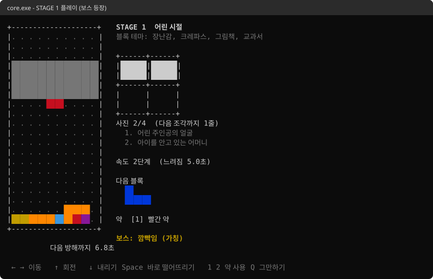
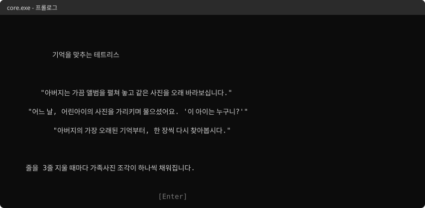
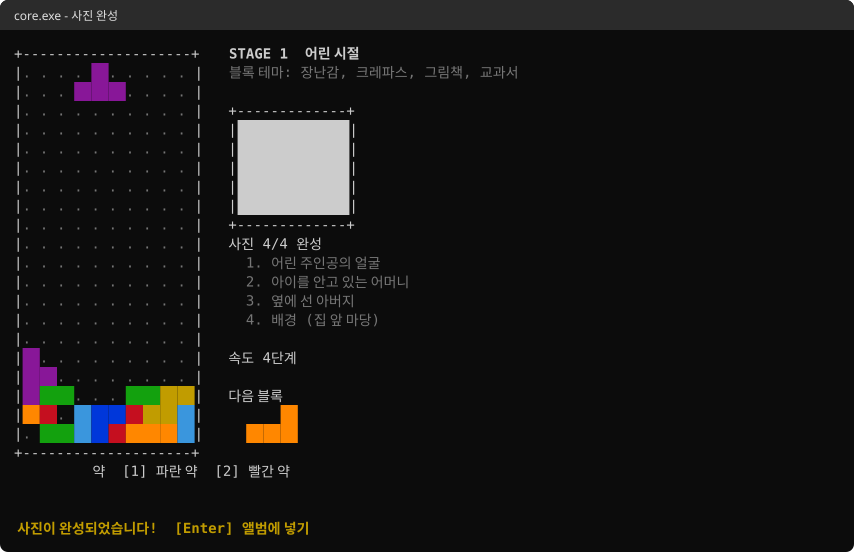
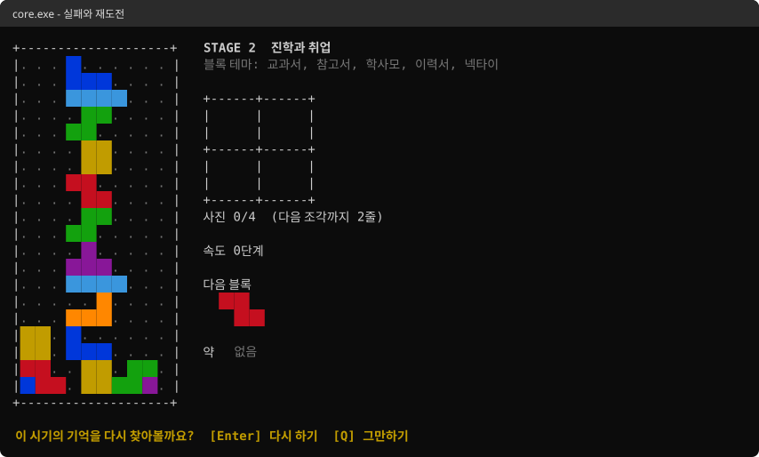
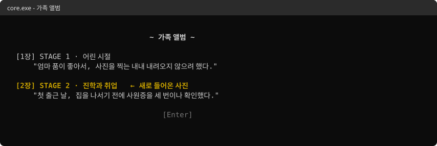
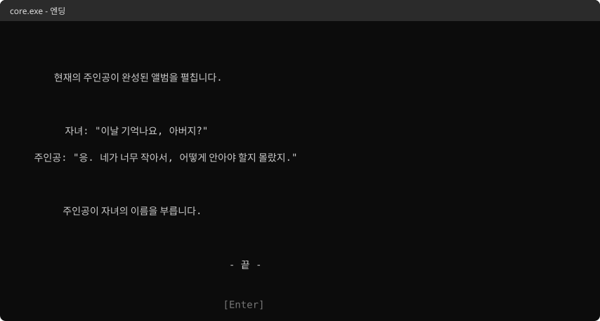

# 기억을 맞추는 테트리스 (ku-oop2-tetris)

C++로 구현한 콘솔 테트리스 게임입니다. 객체 지향 설계(OCP, DIP, CQS)를 학습하기 위해 제작했습니다.

알츠하이머로 삶의 일부를 잊어버린 주인공이 어린 시절부터 자신의 인생을 다시 돌아보며 가족과 함께한 기억을 찾아가는 이야기입니다.
줄을 지울 때마다 가족사진 조각이 채워지고, 사진을 완성하면 앨범에 한 장씩 모입니다.



## 목차

1. [게임 소개](#게임-소개)
2. [기술 스택](#기술-스택)
3. [게임 실행 방법](#게임-실행-방법)
4. [실행 화면](#실행-화면)
5. [클래스 다이어그램](#클래스-다이어그램)
6. [프로젝트 구조](#프로젝트-구조)
7. [게임 설정 바꾸기](#게임-설정-바꾸기)

---

## 게임 소개

| 요소 | 내용 |
|---|---|
| 스테이지 3개 | 어린 시절 → 진학과 취업 → 결혼과 출산. 스테이지마다 4조각으로 나뉜 가족사진 한 장을 채웁니다. |
| 사진 조각 | 줄을 **3줄** 지울 때마다 조각 1개가 채워지고, 블록 낙하 속도가 한 단계 빨라집니다. |
| 보스 | 사진이 **절반(2/4)** 채워지면 등장해 방해하고, 사진을 완성하면 사라집니다. |
| 약 | 사진 조각을 채울 때마다 하나씩 받습니다. 파란 약은 낙하 속도를 늦추고, 빨간 약은 맨 아래 줄을 없앱니다. |
| 실패와 재도전 | 새 블록을 놓을 공간이 없으면 실패합니다. 재도전하면 그 스테이지의 시작 상태로 돌아갑니다. |

| 보스 (이름은 가칭) | 스테이지 | 방해 기믹 |
|---|---|---|
| 깜빡임 | 1 | 보드의 가로 몇 줄이 잠시 어두워져 블록이 가려집니다. |
| 뒤바뀜 | 2 | 떨어지던 블록이 갑자기 다른 모양으로 바뀝니다. |
| 잊혀짐 | 3 | 쌓아 둔 블록 중 몇 칸이 사라집니다. |

---

## 기술 스택

| 구분 | 사용 기술 |
|---|---|
| 언어 | C++20 (표준 C++만 사용, 컴파일러 확장 기능 끔) |
| 표준 라이브러리 | STL 컨테이너(`vector`, `array`, `map`), `unique_ptr`, `<random>`, `<chrono>`, `<thread>`, `<algorithm>` |
| 빌드 | CMake 3.20 이상 |
| 컴파일러 | Windows: MSVC (Visual Studio) / Mac: Apple Clang |
| 콘솔 출력 | ANSI 이스케이프 코드 (색, 커서 이동) |
| 키 입력 | Windows: `<conio.h>`, `<windows.h>` / Mac: `<termios.h>` |
| 설계 문서 | draw.io (클래스 다이어그램) |
| 협업 | Git, GitHub (개인 브랜치 + PR) |

---

## 게임 실행 방법

### Windows: Visual Studio

1. Visual Studio Installer에서 **C++를 사용한 데스크톱 개발** 워크로드를 설치합니다. (CMake가 함께 설치됩니다)
2. Visual Studio에서 **파일 → 열기 → 폴더**로 `ku-oop2-tetris` 폴더를 엽니다.
3. 위쪽 시작 항목에서 `core.exe`를 선택하고 실행합니다.

### Windows: cmd에서 빌드하고 실행

시작 메뉴에서 **Developer Command Prompt for VS**를 열고 저장소 폴더로 이동한 뒤 실행합니다.

```bash
cmake -S . -B build
```

```bash
cmake --build build --config Release
```

```bash
build\Release\core.exe
```

> 생성기를 Ninja로 지정했다면(`-G Ninja`) 실행 파일은 `build\core.exe`에 만들어집니다.

### Mac: 터미널

```bash
xcode-select --install
```

```bash
brew install cmake
```

```bash
cmake -S . -B build && cmake --build build
```

```bash
./build/core
```

### 실행 환경 팁

- 창 크기는 **가로 100칸, 세로 30줄 이상**을 권장합니다. 창이 작으면 화면 아래쪽이 잘립니다.
- 한글이 나오는 글꼴(예: 기본 글꼴, D2Coding)을 사용합니다.
- Windows 10 이상의 콘솔(cmd, PowerShell, Windows Terminal)은 ANSI 색 코드를 지원하므로 그대로 실행하면 됩니다.

### 조작법

| 키 | 동작 |
|---|---|
| `←` `→` (또는 `A` `D`) | 좌우 이동 |
| `↑` (또는 `W`, `X`) | 시계 방향 회전 |
| `↓` (또는 `S`) | 한 칸 내리기 |
| `Space` | 바로 떨어뜨리기 |
| `1` `2` | 1번·2번 칸의 약 사용 |
| `Enter` | 다음 장면으로 / 재도전 |
| `Q` `Esc` | 게임 종료 |

---

## 실행 화면

> 실제 게임(`ConsoleIO`)이 출력한 화면을 그대로 이미지로 옮겼습니다.

| 프롤로그 | 플레이 (STAGE 1 보스 등장) |
|---|---|
|  |  |
| 주인공이 기억을 잃었다는 이야기로 시작합니다. | 가운데 회색 줄은 보스가 가린 칸입니다. 오른쪽에 4분할 사진 틀, 진행도, 속도, 다음 블록, 약, 보스 정보가 나옵니다. |

| 사진 완성 | 실패와 재도전 |
|---|---|
|  |  |
| 사진 4조각을 모두 채우면 경계선이 사라지고 한 장으로 합쳐집니다. | 블록을 놓을 공간이 없으면 실패하고, Enter로 그 스테이지를 처음부터 다시 합니다. |

| 가족 앨범 | 엔딩 |
|---|---|
|  |  |
| 완성한 사진이 앨범에 한 장씩 들어갑니다. | 세 장의 사진을 모두 모으면 주인공이 가족을 알아봅니다. |

---

## 클래스 다이어그램

[클래스 다이어그램 보기 (docs/class-diagram.md)](docs/class-diagram.md)

---

## 프로젝트 구조

```
ku-oop2-tetris/
├── CMakeLists.txt          빌드 설정 (tetris/core 아래 .cpp·.h 자동 포함)
├── docs/
│   ├── CONVENTION.md       개발 컨벤션
│   ├── class-diagram.md    클래스 다이어그램 설명
│   ├── oop-tetris-class-diagram.drawio
│   └── images/             다이어그램·실행 화면 이미지
└── tetris/core/
    ├── main.cpp            구체 클래스를 만들어 조립하고 게임 실행
    ├── common/             Point
    ├── block/              Tetromino, 7종 블록, PieceGenerator, BagPieceGenerator
    ├── board/              Board
    ├── play/               PlayField, FallSpeed, EffectTarget, PlayListener
    ├── stage/              Stage, StageSession, PhotoProgress, Album
    ├── boss/               Boss, DarknessBoss, ShapeShiftBoss, ForgetBoss
    ├── medicine/           Medicine, BluePill, RedPill, MedicineInventory
    ├── ui/                 Renderer, InputSource, Action, ConsoleIO
    └── flow/               Game, Scene, StoryScene, PlayScene, AlbumScene
```

---

## 게임 설정 바꾸기

기획안에서 아직 정해지지 않은 수치는 [`tetris/core/main.cpp`](tetris/core/main.cpp) 맨 위의 설정 상수에 모아 두었습니다. 숫자만 바꾸고 다시 빌드하면 됩니다.

| 상수 | 기본값 | 뜻 |
|---|---|---|
| `linesPerPhotoPiece` | 3 | 사진 조각 하나에 필요한 줄 수 |
| `startFallIntervalMs` | 800 | 스테이지 시작 낙하 간격 (ms) |
| `fallIntervalStepMs` | 100 | 조각마다 줄어드는 낙하 간격 (ms) |
| `minFallIntervalMs` | 150 | 가장 빠른 낙하 간격 (ms) |
| `slowMultiplier` | 2 | 파란 약을 먹었을 때 느려지는 배수 |
| `medicineCapacity` | 2 | 약 보유 한도 |
| `bluePillDurationMs` | 5000 | 파란 약 지속 시간 (ms) |

보스의 이름, 발동 주기, 지속 시간은 같은 파일의 `makeStages()`에서 바꿉니다.

