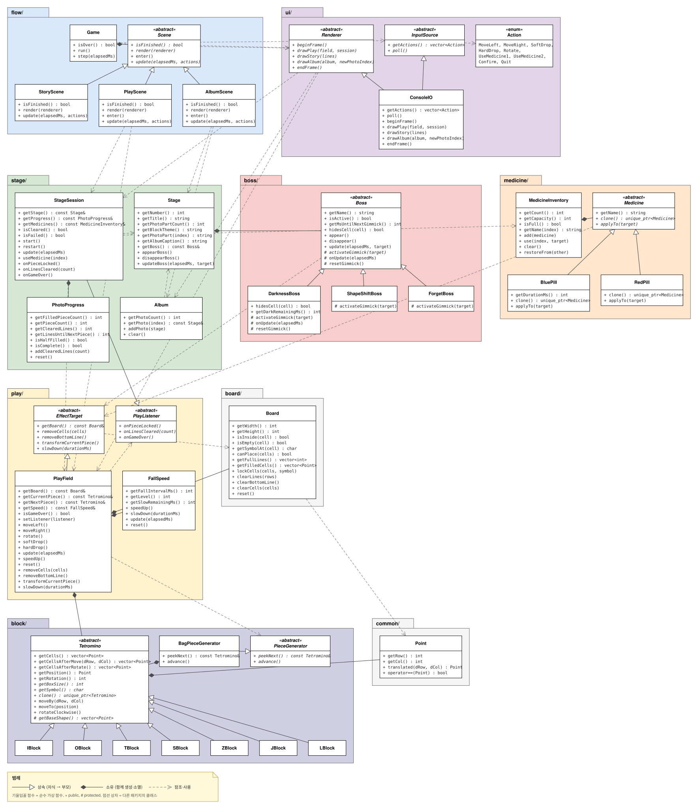
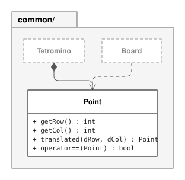
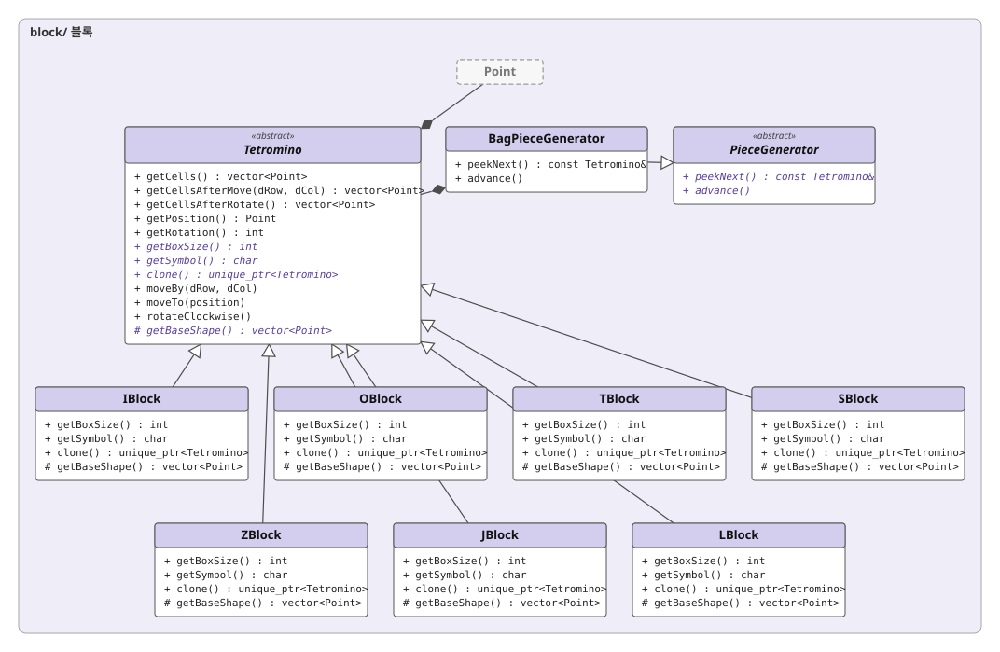
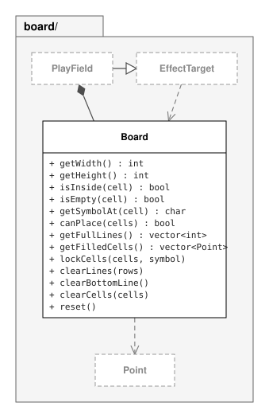
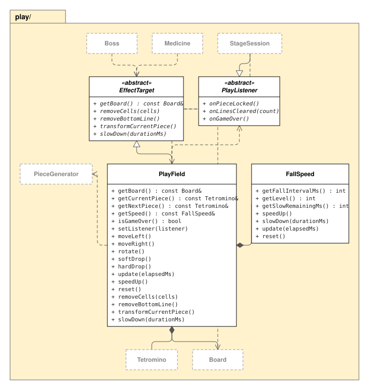
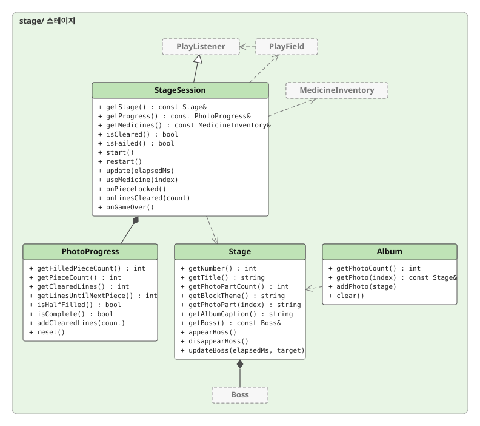
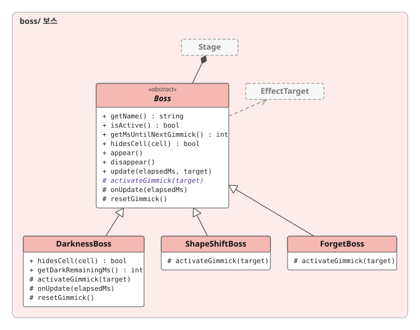
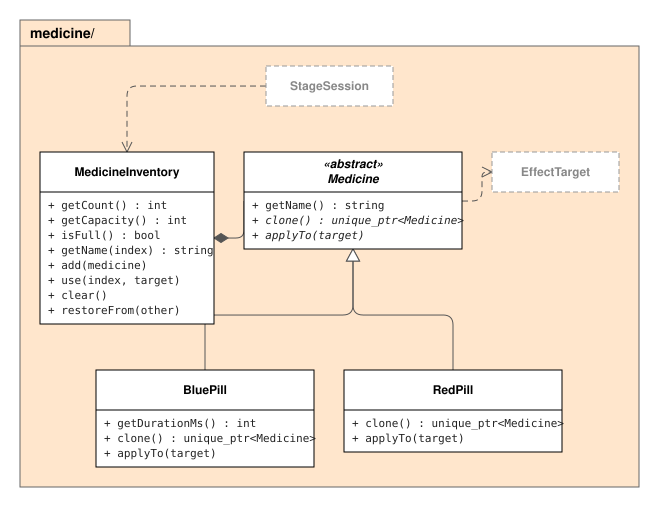
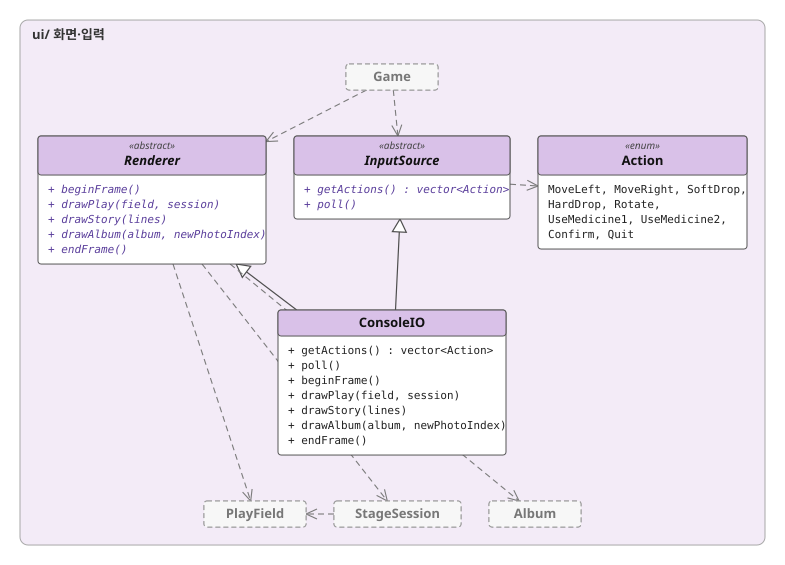
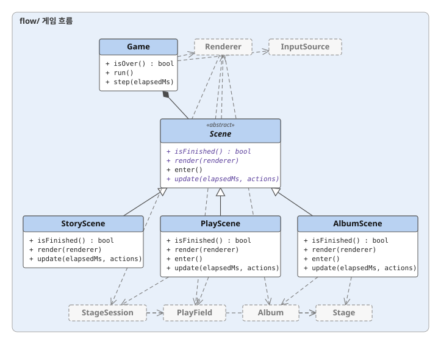

# 클래스 다이어그램

게임 전체가 어떤 클래스로 나뉘어 있고, 서로 어떻게 연결되는지 정리한 문서다.
한눈에 보기 쉽도록 **클래스마다 메서드(public, protected)만** 적고, 필드·생성자·private 함수는 뺐다.

- 원본 파일: [`oop-tetris-class-diagram.drawio`](oop-tetris-class-diagram.drawio)
  - [app.diagrams.net](https://app.diagrams.net)에서 **파일 → 열기**로 연다.
  - 페이지 10개: `전체` 1장과 패키지별 9장(`common` ~ `flow`)
- 패키지는 `tetris/core/` 아래 폴더와 같다. (예: `block/` 패키지 = `tetris/core/block/` 폴더)

## 읽는 법

| 표기 | 뜻 |
|---|---|
| 실선 + 빈 삼각형 | 상속. 화살표가 부모 클래스를 가리킨다. |
| 채운 마름모 | 소유. 마름모 쪽 클래스가 상대 객체를 멤버로 가지고, 함께 만들어지고 함께 사라진다. |
| 점선 + 열린 화살표 | 참조·사용. 화살표 쪽 객체를 참조로 받아서 쓴다. |
| 탭이 달린 폴더 모양 | 패키지 (`tetris/core/` 아래 폴더) |
| `«abstract»`, 굵은 기울임꼴 이름 | 추상 클래스 |
| `«enum»` | 열거형 |
| 기울임꼴 메서드 | 순수 가상 함수 (자식 클래스가 반드시 구현) |
| `+` / `#` | public / protected |
| 점선 상자 (패키지별 그림) | 다른 패키지의 클래스. 연결 관계를 보여 주려고 이름만 그렸다. |

---

## 1. 전체 구조



의존 방향은 위에서 아래로 흐른다.

```
flow (게임 흐름)
 ├─ ui (화면·입력)         ← 추상 클래스 Renderer, InputSource
 └─ stage (스테이지 규칙)
      ├─ boss, medicine    ← 추상 클래스 Boss, Medicine
      └─ play (한 판 진행)  ← 추상 클래스 EffectTarget, PlayListener
           ├─ board
           └─ block        ← 추상 클래스 Tetromino, PieceGenerator
                └─ common
```

- 아래쪽 패키지(도메인)는 위쪽 패키지(화면, 게임 흐름)를 모른다. 그래서 콘솔 화면을 그래픽으로 바꿔도 도메인 코드는 고치지 않는다.
- 패키지 사이는 대부분 **추상 클래스**로 연결된다. 구체 클래스(`IBlock`, `DarknessBoss`, `BluePill`, `ConsoleIO`, `PlayScene` 등)는 `main.cpp`에서만 만든다. (컨벤션 5장 DIP)

| 추상 클래스 | 하는 일 | 구현 클래스 |
|---|---|---|
| `Tetromino` | 블록 모양·이동·회전 | `IBlock` `OBlock` `TBlock` `SBlock` `ZBlock` `JBlock` `LBlock` |
| `PieceGenerator` | 다음 블록 고르기 | `BagPieceGenerator` |
| `EffectTarget` | 보스·약이 게임에 거는 효과 | `PlayField` |
| `PlayListener` | 줄 삭제·게임 오버 알림 받기 | `StageSession` |
| `Boss` | 주기마다 방해 기믹 발동 | `DarknessBoss` `ShapeShiftBoss` `ForgetBoss` |
| `Medicine` | 플레이어를 돕는 약 | `BluePill` `RedPill` |
| `Renderer` | 화면 그리기 | `ConsoleIO` |
| `InputSource` | 키 입력 받기 | `ConsoleIO` |
| `Scene` | 게임의 한 장면 | `StoryScene` `PlayScene` `AlbumScene` |

---

## 2. 패키지별 다이어그램

### 2.1 common — 공통



- `Point`는 보드 위의 한 칸(행, 열)이다. 블록이 차지하는 칸, 보드에서 지울 칸 등을 모두 `Point`로 주고받는다.
- 값을 바꾸지 않는 클래스다. 옮긴 위치가 필요하면 `translated()`로 새 `Point`를 만든다.

### 2.2 block — 블록



- `Tetromino`가 이동·회전·칸 계산을 모두 처리하고, 7종 블록은 **모양(`getBaseShape`), 회전 상자 크기, 기호, `clone`**만 정한다.
  - 회전은 정사각형 상자 안에서 90도 돌리는 공식 하나로 계산하므로, 블록마다 회전 상태 4개를 따로 적지 않는다.
- `getCellsAfterMove()`, `getCellsAfterRotate()`는 블록을 실제로 움직이지 않고 "움직였다면 차지할 칸"만 알려 준다. 보드가 충돌을 미리 검사할 때 쓴다. (CQS)
- `BagPieceGenerator`는 7종을 가방에 넣고 섞어서 하나씩 꺼낸다. 원형 블록은 `main`이 만들어 넘기고, 생성기는 `clone()`으로 복사해서 쓴다. 그래서 생성기는 구체 블록 클래스를 모른다.
- **확장**: 새 블록은 `Tetromino`를 상속한 클래스를 만들고 `main`의 원형 목록에 넣으면 된다.

### 2.3 board — 보드



- `Board`는 칸마다 쌓인 블록의 **기호(`char`)만** 저장한다. 블록 종류를 모르기 때문에 새 블록이 생겨도 고치지 않는다.
- 놓을 수 있는지 검사(`canPlace`), 블록 고정(`lockCells`), 꽉 찬 줄 찾기·지우기 외에 보스와 약을 위한 기능이 있다.
  - `clearBottomLine()`: 맨 아래 한 줄 삭제 (빨간 약)
  - `clearCells()`: 칸만 비우고 위의 블록은 그대로 둠 (STAGE 3 보스)

### 2.4 play — 한 판 진행



- `PlayField`가 테트리스 한 판을 진행한다. 조작(이동·회전·내리기), 시간에 따른 낙하(`update`), 고정, 줄 삭제, 다음 블록, 게임 오버를 처리한다.
  - 화면 출력과 키 입력은 하지 않고, 시간도 `update(elapsedMs)`로 전달받는다.
- `FallSpeed`는 낙하 간격을 관리한다. 사진 조각마다 단계가 오르고, 파란 약을 먹으면 일정 시간 느려진다.
- **추상 클래스 두 개로 바깥과 연결된다.**
  - `EffectTarget`: 보스와 약이 `PlayField`에 효과를 거는 통로. 보스·약은 `PlayField`를 직접 모른다.
  - `PlayListener`: `PlayField`가 줄 삭제·게임 오버를 알리는 대상. `PlayField`는 사진 조각이나 보스 같은 스테이지 규칙을 모른다.

### 2.5 stage — 스테이지



- `Stage`는 스테이지 하나의 내용이다. 제목, 블록 테마, 사진 조각 4개의 설명, 앨범 문구, 보스를 가진다. 내용은 모두 `main`에서 넘겨준다.
- `StageSession`은 기획안 3장의 규칙을 맡는다. `PlayListener`로 줄 삭제를 전달받아서
  - 3줄마다 사진 조각을 채우고(`PhotoProgress`), 조각마다 속도를 올리고 약을 준다.
  - 사진이 2/4가 되면 보스를 부르고, 4/4가 되면 보스를 보내고 클리어한다.
  - 실패하면 `restart()`로 보드·사진·속도·보스·약을 스테이지 시작 상태로 되돌린다.
- `Album`은 클리어한 스테이지의 사진을 순서대로 모은다.

### 2.6 boss — 보스



- `Boss`가 등장·퇴장과 "주기마다 기믹 발동"을 처리하고, 자식 클래스는 기믹(`activateGimmick`)만 구현한다.
  - 효과가 일정 시간 이어지는 보스는 `onUpdate()`, 남은 효과를 지워야 하는 보스는 `resetGimmick()`를 오버라이드한다.

| 보스 | 스테이지 | 기믹 |
|---|---|---|
| `DarknessBoss` | 1 (단기기억상실) | 보드의 가로 몇 줄을 일정 시간 가린다. 화면이 `hidesCell()`을 보고 가린다. |
| `ShapeShiftBoss` | 2 | 떨어지는 블록을 다른 모양으로 바꾼다. |
| `ForgetBoss` | 3 (까먹음) | 쌓인 칸 몇 개를 무작위로 지운다. |

- **확장**: 새 보스는 `Boss`를 상속해 `activateGimmick()`만 구현하고 `main`에서 스테이지에 넘기면 된다.

### 2.7 medicine — 약



- `Medicine`을 상속한 약은 `applyTo()`에서 `EffectTarget`으로 효과를 건다.
  - `BluePill`: 일정 시간 낙하 속도를 늦춘다.
  - `RedPill`: 맨 아래 한 줄을 없앤다.
- `MedicineInventory`는 가진 약 목록이다. 보유 한도가 있고, 칸 번호로 골라 쓴다.
  - 재도전을 위해 스테이지를 시작할 때 복사본을 만들어 두고, 실패하면 `restoreFrom()`으로 되돌린다. 복사할 때 약은 `clone()`으로 새로 만든다.
- **확장**: 새 약은 `Medicine`을 상속해 `applyTo()`, `clone()`을 구현하면 된다.

### 2.8 ui — 화면·입력



- `Renderer`는 "무엇을 그릴지"(플레이 화면, 자막, 앨범)만 정한 추상 클래스이고, `InputSource`는 입력을 조작(`Action`)으로 바꿔 주는 추상 클래스다.
- `ConsoleIO`가 둘을 모두 구현한다. Windows와 Mac에서 다른 코드(`windows.h`, `conio.h`, `termios.h`)는 **이 클래스 안에만** 있다. (컨벤션 8장)
- **확장**: 그래픽 화면은 `Renderer`, `InputSource`를 구현한 새 클래스를 만들고 `main`에서 `ConsoleIO` 대신 넘기면 된다. 게임 코드는 고치지 않는다.

### 2.9 flow — 게임 흐름



- `Game`은 게임 루프다. 매 프레임 "입력 모으기 → 장면 진행 → 화면 그리기"를 반복한다.
- `Scene`을 상속한 장면을 `main`이 순서대로 만들어 넘긴다.
  - 프롤로그(`StoryScene`) → (스테이지 소개 `StoryScene` → 플레이 `PlayScene` → 앨범 `AlbumScene`) × 3 → 엔딩(`StoryScene`)
- `PlayScene`은 조작을 `PlayField`·`StageSession`의 커맨드로 바꿔 전달하고, 실패하면 Enter로 재도전한다.
- **확장**: 새 장면은 `Scene`을 상속한 클래스를 만들고 `main`의 장면 목록에 넣으면 된다. `Game`은 고치지 않는다.

---

## 다이어그램 고치기

- 코드가 바뀌면 [`oop-tetris-class-diagram.drawio`](oop-tetris-class-diagram.drawio)의 `전체` 페이지와 해당 패키지 페이지를 함께 고친다.
- 이 문서의 그림은 `images/class-diagram/` 아래의 SVG 파일이다. draw.io에서 고친 페이지를 **파일 → 내보내기 → SVG**로 내보내 같은 이름으로 바꿔 넣는다.
